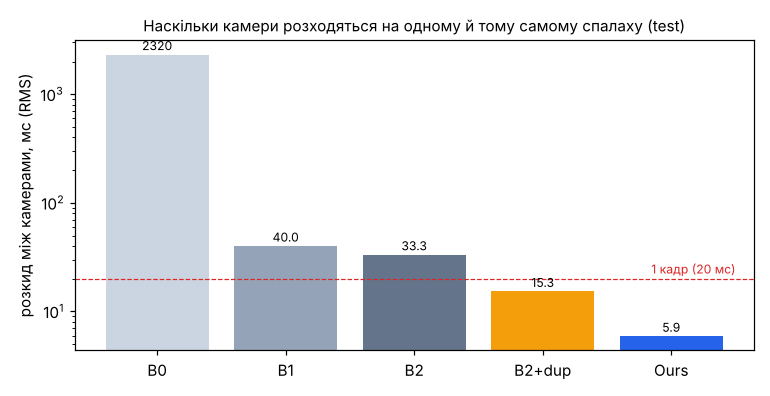
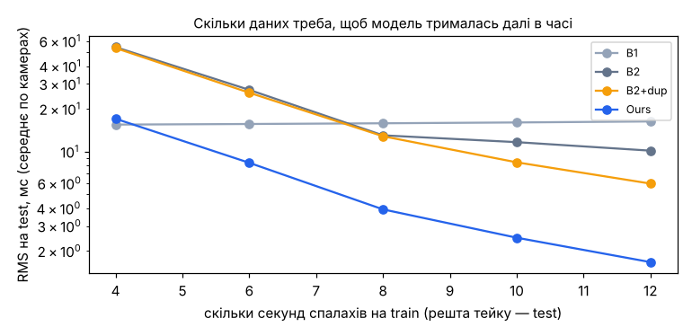

# FlashSync

Синхронізація 8-камерного відео мокап-студії за спалахами світлодіодів ESP32.
Курсовий проєкт з Computer Vision (robotdreams), захист 16.11.2026.

## Задача

8 камер Xiaomi Yi (MJPEG AVI, 1920×1080 @ 50 fps, запис через Mocap Director) не мають апаратного genlock:

- **зсув (offset)** — камери стартують по черзі, з кроком ~0.5 с;
- **дрейф (drift)** — годинники трактів відрізняються на сотні ppm, тож зсув росте з часом;
- **повтори кадрів** — карта захоплення інколи дублює кадр, і всі наступні кадри зсуваються.

ESP32 блимає світлодіодами (2–4 у полі зору кожної камери), а Mocap Director пише лог
`esp32_flashes.txt` з часом кожного спалаху за годинником ESP32. **Цей лог — ground truth.**

Мета: для кожної камери знайти `t_esp = a · t_cam + b` і показати, що похибка синхронізації
менша за один кадр (20 мс).

## Структура

```
flashsync/      бібліотека: io, led_detect, flash_detect, subframe, fit, evaluate
scripts/        CLI-скрипти
tests/          pytest; tests/data — короткі фрагменти справжніх логів
notebooks/      аналіз і графіки для презентації
results/        графіки й таблиці (без сирих відео)
docs/PLAN.md    план проєкту
```

## Встановлення

```bash
pip install -r requirements.txt
pytest
python scripts/inspect_take.py "шлях/до/Take_001"
```

Сирі AVI в репозиторій не потрапляють (`.gitignore`).

## Прогрес

- [x] `io.py` — читання AVI, парсер `esp32_flashes.txt`, час старту камер з `ffmpeg.log`
- [x] `led_detect.py` — автоматичний пошук LED (epoch folding + Otsu + морфологія + connected components)
- [x] `flash_detect.py` — моменти спалахів (ковзний фон, поріг Otsu/σ, об'єднання LED, повтори кадрів)
- [x] `subframe.py` — уточнення через rolling shutter і часткову засвітку + поправка на нерегулярні повтори кадрів
- [x] `fit.py` — зіставлення з ESP32 (якір MASTER) і регресія offset + drift; базові методи B0/B1/B2
- [x] `evaluate.py` — train/test, базові методи B0–B2, міжкамерна похибка, графіки
- [ ] демо до/після

## Результати

### Пошук LED (`led_detect.py`)

Тейк 2Avitest (6 камер, 1080p50, у кадрі ходить актор). Ручна розмітка — 16 LED.
Знайдений LED вважається правильним, якщо він ближче 12 px до ручної позначки.

| Метод | Recall | Precision | Похибка центру |
|---|---|---|---|
| Базовий: `max − median` → Otsu → відкриття → компоненти | 6/16 (38%) | 6/6 | 1.3 px |
| **Наш: epoch folding → Otsu/MAD → закриття → компоненти + перевірка періодичності** | **16/16 (100%)** | 16/19 (84%) | 3.4 px |


Чому базовий метод не працює: у карті `max − median` рух актора яскравіший за тьмяні LED,
і поріг Otsu стає між ними — тьмяні LED губляться (CAM01, CAM02, CAM08 — жодного).
Синхронне усереднення по періоду ESP32 (1 с) розмазує рух актора по всіх фазах і лишає
гострий пік лише там, де світло блимає в ритм.

Три «зайві» знахідки (CAM02, CAM07, CAM08) теж блимають у ритм ESP32 з періодичністю 0.83–0.90:
це LED біля краю кадру або їхні відблиски на стіні, які не були розмічені вручну. Для
синхронізації вони не шкодять — це той самий сигнал.

Відтворити:

```bash
python scripts/detect_leds.py <тейк> --reference results/led_detect/2Avitest_Take001/manual_leds.json --method naive
python scripts/detect_leds.py <тейк> --reference results/led_detect/2Avitest_Take001/manual_leds.json --method folded
```

### Спалахи і зіставлення з ESP32 (`flash_detect.py`, `fit.py`)

```bash
python scripts/run_take.py <тейк> --leds results/led_detect/2Avitest_Take001/folded/leds.json
```

Той самий тейк 2Avitest (~30 с, 27 спалахів у лозі, LED — з автодетекції, без ручної розмітки).
Точність поки до кадру (кадр = 20 мс):

| Камера | Повторів кадрів | Спалахів зіставлено | Зсув b, с | Дрейф, ppm | RMS залишків, мс |
|---|---|---|---|---|---|
| CAM01 | 766 (25 к/с) | 26/27 | 0.297 | +732 | 5.7 |
| CAM02 | 0 | 26/27 | 0.865 | +188 | 4.0 |
| CAM05 | 0 | 26/27 | 1.322 | +86 | 1.8 |
| CAM06 | 731 (25 к/с) | 26/27 | 1.666 | +259 | 5.4 |
| CAM07 | 1 | 26/27 | 2.251 | +1231 | 4.9 |
| CAM08 | 708 (25 к/с) | 26/27 | 2.599 | −87 | 1.8 |


MASTER-спалах (довгий, ~0.5 с) знайдено на всіх камерах. Зсуви 0.3 → 2.6 с — це послідовне
відкриття камер DirectShow (~0.5 с на камеру). 27-й спалах у лозі — після кінця найкоротшого запису.

**Обмеження точності до кадру.** На 30-секундному тейку дрейф оцінюється дуже грубо (+86…+1231 ppm):
квантування кадром ±10 мс на 30 с дає похибку нахилу ~±700 ppm. Тест
`test_frame_level_cannot_see_small_drift` показує те саме на синтетиці: реальний дрейф 300 ppm
(14 мс за 48 с) менший за кадр, тож усі інтервали рівно по 50 кадрів і B2 бачить дрейф ≈ 0.
Звідси два наступні кроки: довгий тейк (3–5 хв) і субкадрове уточнення (`subframe.py`) —
на графіку вище видно частково засвічені кадри на фронтах спалахів, саме з них береться субкадрова інформація.

### Субкадрове уточнення (`subframe.py`)

Модель експозиції: рядок на висоті y кадру n бачить світло з інтервалу
`[t_n + R·y, t_n + R·y + E]` (R — час зчитування сенсора, E — експозиція). Частково засвічений
кадр на фронті спалаху дає частку f, звідки `t_спалаху = t_n + R·y + E·(1 − f)`.
E і R підбираються перебором за мінімумом залишків на train-спалахах. Фронти вимкнення
дають другу оцінку (мінус тривалість спалаху, теж оцінена з даних).

**Знахідка: нерегулярні повтори кадрів.** У камерах, що віддають 25 к/с, повтор «через кадр»
займає свій 40-мс слот — поправка не потрібна. Але поодинокий повтор (збій захоплення) вставляє
слот, якого не було в часі камери: усі наступні кадри насправді на 1 кадр раніше. На графіку це
сходинка рівно в −20 мс (CAM01 на 10.4 с, CAM07 на 16.8 с).

```bash
python scripts/subframe_ablation.py <тейк>
```

Тейк 2Avitest, 6 камер. Модель підганяється на першій половині спалахів (train), похибка — на другій (test):

| Метод | Середній RMS на test, мс | Найгірший спалах, мс |
|---|---|---|
| B2: зсув + дрейф, точність до кадру | 9.49 | 28.6 |
| B2 + поправка на нерегулярні повтори | 5.08 | 16.8 |
| субкадрове уточнення без поправки | 7.96 | 32.4 |
| **субкадрове уточнення + поправка (наш)** | **1.51** | **4.8** |

| Камера | B2 | B2+dup | subframe | **subframe+dup** | E, мс | R, мс |
|---|---|---|---|---|---|---|
| CAM01 (25 к/с, 1 нерегулярний повтор) | 18.4 | 3.8 | 21.0 | **1.3** | 40 | 36 |
| CAM02 | 3.8 | 3.8 | 0.8 | **0.8** | 17 | 20 |
| CAM05 | 3.8 | 3.8 | 0.4 | **0.4** | 20 | 18 |
| CAM06 (25 к/с) | 11.4 | 11.4 | 3.3 | **3.3** | 40 | 36 |
| CAM07 (1 нерегулярний повтор) | 15.7 | 3.8 | 19.6 | **0.6** | 19 | 19 |
| CAM08 (25 к/с) | 3.8 | 3.8 | 2.7 | **2.7** | 26 | 40 |


Обидві частини потрібні разом: без поправки на повтори сходинка в один кадр «з'їдає» виграш
субкадрового уточнення; без субкадрового уточнення лишається квантування кадром.
Підібрані E ≈ R ≈ один кадр (20 мс при 50 к/с, 40 мс у камер з 25 к/с) — фізично правдоподібно.

Обмеження: тейк короткий (30 с, 13 test-спалахів на камеру); на довгому тейку оцінка надійніша.

## Підсумкова оцінка (`evaluate.py`)

```bash
python scripts/run_take.py <тейк> --leds <leds.json>     # сигнали LED (один прохід по відео)
python scripts/evaluate_take.py <тейк>                   # таблиця + графіки → results/eval/<тейк>/
```

Протокол: спалахи кожної камери ділимо за часом навпіл — модель підганяємо на першій половині
(train), похибку міряємо на другій (test). «Розкид між камерами» — для кожного test-спалаху,
який бачать усі камери, різниця між найбільшою і найменшою похибкою камер: саме настільки камери
розходяться в часі на одній події, що й важливо для тріангуляції.

Тейк 2Avitest (6 камер, ~30 с, по 13 test-спалахів на камеру):

| Метод | RMS відносно ESP32, мс (середнє по камерах) | Найгірший спалах, мс | Розкид між камерами RMS / max, мс |
|---|---|---|---|
| B0 — за номером кадру | 1190 | 2290 | 2320 / 2320 |
| B1 — зсув з MASTER, без дрейфу | 16.5 | 30.0 | 40.0 / 40.0 |
| B2 — зсув + дрейф, до кадру | 9.5 | 28.6 | 33.3 / 43.0 |
| B2 + поправка на повтори кадрів | 5.1 | 16.8 | 15.3 / 22.5 |
| **Ours — субкадрове уточнення + поправка** | 1.5 | 4.8 | 5.9 / 8.7 |

| Камера | test-спалахів | B0 | B1 | B2 | B2+dup | Ours | дрейф Ours, ppm | E, мс | R, мс |
|---|---|---|---|---|---|---|---|---|---|
| CAM01 | 13 | 29.7 | 10.0 | 18.4 | 3.8 | 1.3 | -111 | 40 | 36 |
| CAM02 | 13 | 550 | 10.0 | 3.8 | 3.8 | 0.8 | -72 | 17 | 20 |
| CAM05 | 13 | 1010 | 10.0 | 3.8 | 3.8 | 0.4 | -19 | 20 | 18 |
| CAM06 | 13 | 1350 | 30.0 | 11.4 | 11.4 | 3.3 | +299 | 40 | 36 |
| CAM07 | 13 | 1912 | 28.9 | 15.7 | 3.8 | 0.6 | -33 | 19 | 19 |
| CAM08 | 13 | 2290 | 10.0 | 3.8 | 3.8 | 2.7 | -235 | 26 | 40 |




**Висновки:**
- Без синхронізації (B0) камери розходяться на 2.3 с — це послідовне відкриття камер DirectShow.
- Один MASTER-спалах (B1) прибирає зсув, але лишає ~1–2 кадри розбіжності.
- Зсув + дрейф з точністю до кадру (B2) — 33 мс розкиду між камерами: більше за кадр.
- Поправка на нерегулярні повтори кадрів удвічі зменшує розкид (15 мс), субкадрове уточнення —
  ще в 2.6 раза: **5.9 мс між камерами, 1.5 мс відносно ESP32** (кадр = 20 мс).
- Графік «скільки даних треба»: Ours виходить нижче за пів кадру вже з 6 с спалахів на train,
  B2 так і не опускається нижче ~10 мс.

**Обмеження:** тейк лише 30 с — дрейф (сотні ppm) за цей час дає мілісекунди, тож різниця
між методами з дрейфом і без помірна. На довгому тейку (3–5 хв) вона буде помітнішою; скрипти
працюють без змін.

